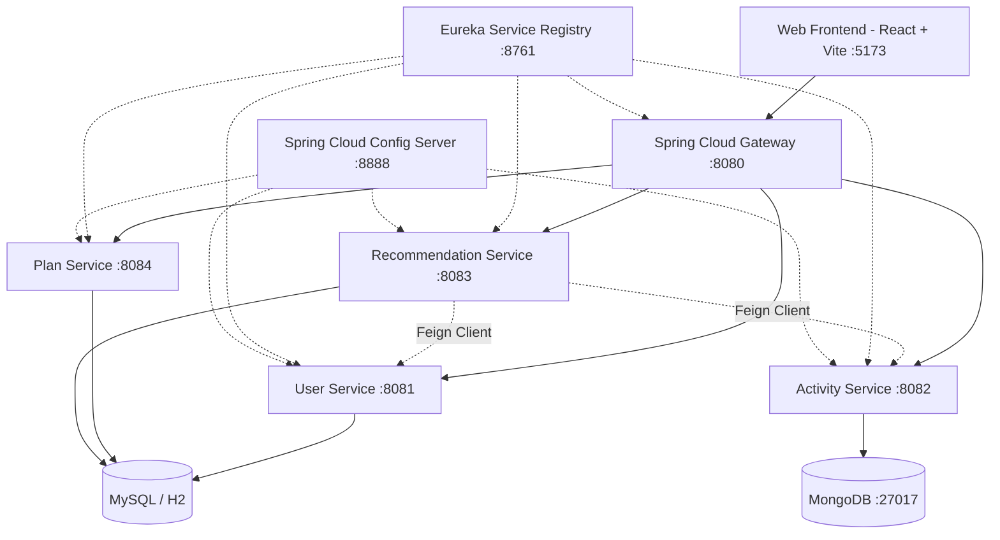

# FitTrack - Microservices Fitness & Nutrition Management Platform

A robust, enterprise-grade microservices-based fitness and nutrition management platform built with Spring Boot, Spring Cloud, Spring Cache, and React.

## System Architecture



## Key Highlights & Features

- **Microservices Architecture**: Decentralized architecture using **Spring Cloud Gateway**, **Eureka Discovery Server**, and **Spring Cloud Config Server**.
- **Personalized Recommendation Engine**: Deterministic sports-science engine utilizing the **Mifflin-St Jeor equation** and Physical Activity Level (PAL) multipliers to calculate Basal Metabolic Rate (BMR), Total Daily Energy Expenditure (TDEE), and goal-oriented macronutrient allocations (Protein, Carbs, Healthy Fats).
- **In-Memory Caching**: Integrated **Spring Cache** (`@EnableCaching`, `@Cacheable`, `@CacheEvict`) across microservices to minimize repetitive database queries and Feign inter-service calls.
- **Activity & Metric Tracking**: High-throughput workout and cardio logging stored in **MongoDB** with flexible document schemas and statistical aggregation.
- **Fitness Plan Management**: 7-day periodized workout and nutritional scheduling with progression tracking.
- **Modern Cyber UI**: Cyber dark responsive dashboard built with **React**, **Vite**, modern CSS glassmorphism, and interactive metric gauges.

## Tech Stack

- **Backend**: Java 21, Spring Boot 3.2.5, Spring Cloud 2023.0.1 (Eureka, Config, Gateway, OpenFeign)
- **Caching**: Spring Cache Abstraction
- **Databases**: MySQL / H2 In-Memory (JPA / Hibernate), MongoDB (Spring Data Mongo)
- **Frontend**: React 18, Vite, React Icons, React Hot Toast
- **Build Tools**: Apache Maven 3.9, Node.js

## Microservices Overview

| Service | Port | Description |
|---|---|---|
| `eureka-server` | 8761 | Service discovery and registry |
| `config-server` | 8888 | Centralized configuration management |
| `api-gateway` | 8080 | Single entry point routing requests to microservices |
| `user-service` | 8081 | Manages user profiles and biometric data |
| `activity-service` | 8082 | Workout logging and statistical analytics (MongoDB) |
| `recommendation-service` | 8083 | Calculates personalized metabolic targets, diet plans, and workouts |
| `plan-service` | 8084 | Manages workout plans and completion statuses |
| `frontend` | 5173 | React single-page application |

## Quick Start (Local Execution)

### Prerequisites
- Java 21 (Temurin JDK)
- Maven 3.9+
- Node.js 18+
- MongoDB (running on `localhost:27017`)

### Starting All Services

Run the automated startup script in PowerShell:

```powershell
.\start-local.ps1
```

This starts:
1. Eureka Server (`http://localhost:8761`)
2. Config Server (`http://localhost:8888`)
3. Domain Microservices (`user-service`, `activity-service`, `recommendation-service`, `plan-service`)
4. API Gateway (`http://localhost:8080`)
5. Frontend UI (`http://localhost:5173`)

### Stopping All Services

```powershell
.\stop-local.ps1
```
