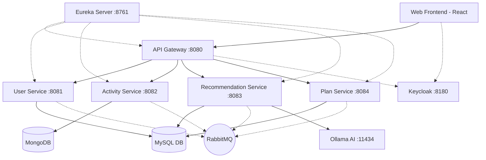

# AI-Powered Fitness Management Platform

Welcome to the AI-Powered Fitness Management Platform, a comprehensive microservices-based application built with Spring Boot, React, and local AI integrations using Ollama.

## Project Architecture



## Features

- **User Management**: Authentication and authorization via Keycloak. Role-based access control (User, Admin).
- **Activity Tracking**: Track fitness activities and metrics efficiently using MongoDB.
- **Smart Recommendations**: Get AI-generated workout recommendations via locally hosted LLMs using Ollama.
- **Plan Management**: Manage workout and fitness plans centrally.
- **Microservices Architecture**: Resilient and scalable backend powered by Spring Boot, Eureka, and API Gateway.
- **Message Queuing**: Asynchronous processing using RabbitMQ.

## Tech Stack

- **Frontend**: React, NGINX
- **Backend**: Java, Spring Boot, Spring Cloud (Eureka, Config, Gateway)
- **Databases**: MySQL 8.0, MongoDB 7.0
- **Message Broker**: RabbitMQ 3.13
- **Security**: Keycloak 24.0 (OpenID Connect / OAuth2)
- **AI/LLM**: Ollama (Default Model: tinyllama)
- **Containerization**: Docker & Docker Compose

## Microservices Overview

| Service | Port | Description |
|---|---|---|
| `eureka-server` | 8761 | Service registry for microservices discovery |
| `config-server` | 8888 | Centralized configuration management |
| `api-gateway` | 8080 | Entry point for external traffic |
| `user-service` | 8081 | Manages user profiles and coordinates with Auth |
| `activity-service` | 8082 | Stores detailed fitness activity logs (MongoDB) |
| `recommendation-service` | 8083 | Connects to Ollama for AI-based insights |
| `plan-service` | 8084 | Manages user fitness and workout plans |
| `frontend` | 3000 | User interface (React hosted on NGINX mapped to 3000) |

## Environment Configuration

Copy the `.env.example` file to `.env` in the root directory before running:

```bash
cp .env.example .env
```
Default configurations:
- **MySQL User**: `fitness_user` / `fitnesspassword`
- **Keycloak Admin**: `admin` / `admin`
- **RabbitMQ**: `fitness` / `fitness123`
- **Ollama**: `tinyllama`

## Quick Start

Make sure Docker and Docker Compose are installed, then run:

```bash
docker compose up --build
```

Wait a couple of minutes for all services to start. Keycloak, databases, RabbitMQ, and Ollama will boot up first, followed by Eureka, and finally the microservices.

## Authentication & Users

The application uses Keycloak for authentication via the `fitness-platform` realm. 

Pre-configured users available for testing:
- **User**: `testuser` (Pass: `Test@1234`)
- **Admin**: `testadmin` (Pass: `Test@1234`)

## AI Flow Explanation

The `recommendation-service` leverages an internal Ollama container. When you spin up the project, an init script (`ollama-init`) waits for Ollama to become healthy and automatically pulls the model defined in `OLLAMA_MODEL` (default: `tinyllama`). The `recommendation-service` then interfaces via standard HTTP REST calls to the Ollama container.

## Troubleshooting

- **Containers failing to start**: Check your Docker memory limits. Running Ollama + multiple Java microservices + Keycloak requires at least 8GB of RAM allocated to Docker.
- **Port Conflicts**: Ensure ports `8080`, `3000`, `3306`, `27017`, `5672`, `8180`, `8761`, and `11434` are free on your host machine.
- **Microservices not registering**: Check Eureka UI at `http://localhost:8761` to ensure services are fully initialized.
